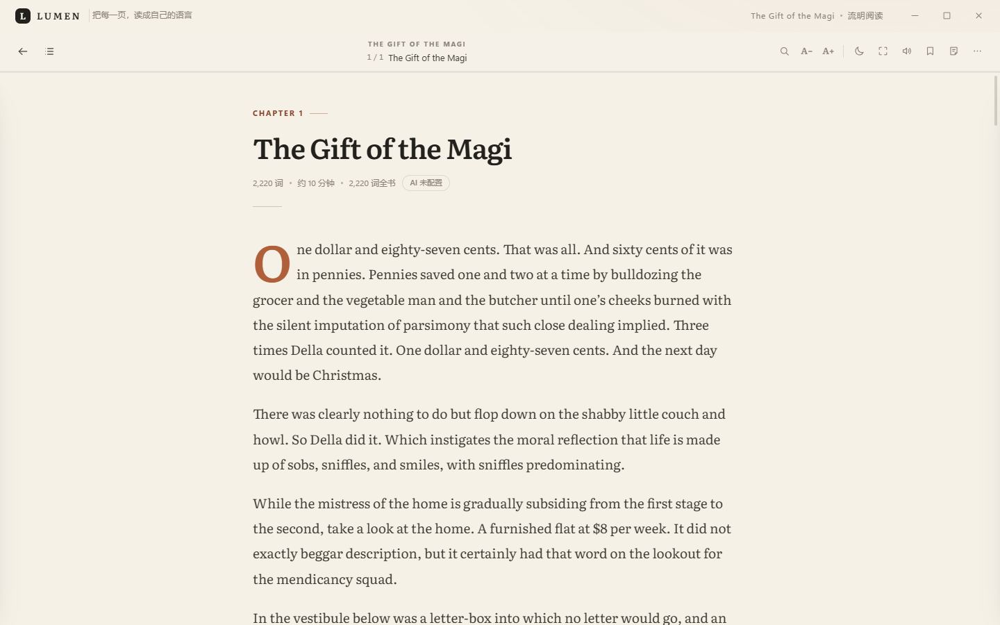
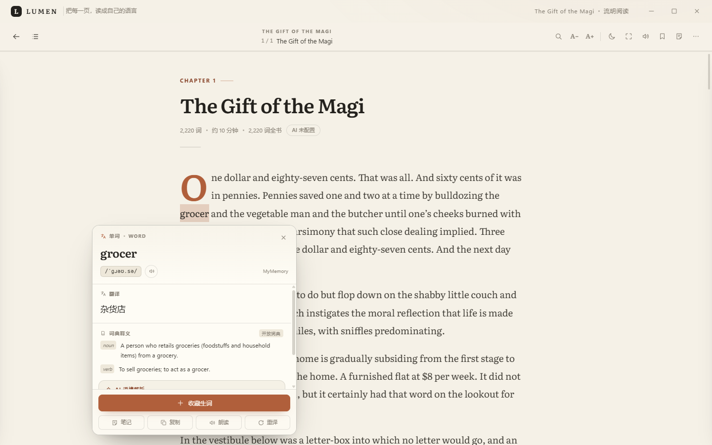
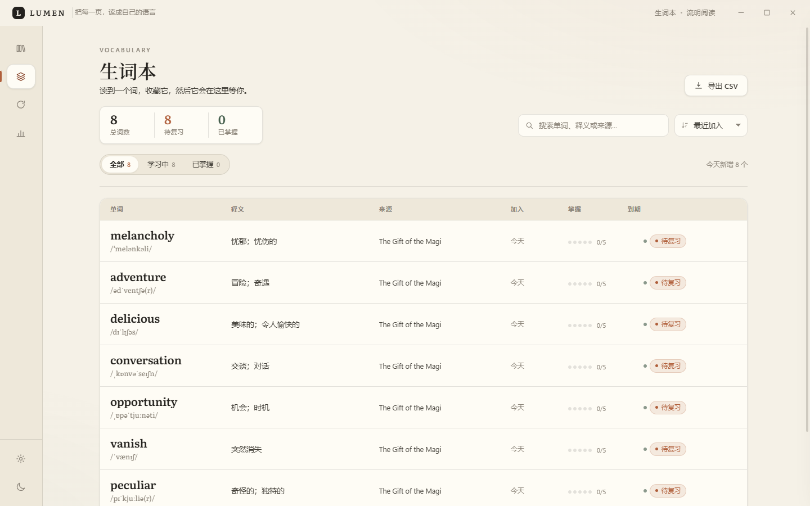
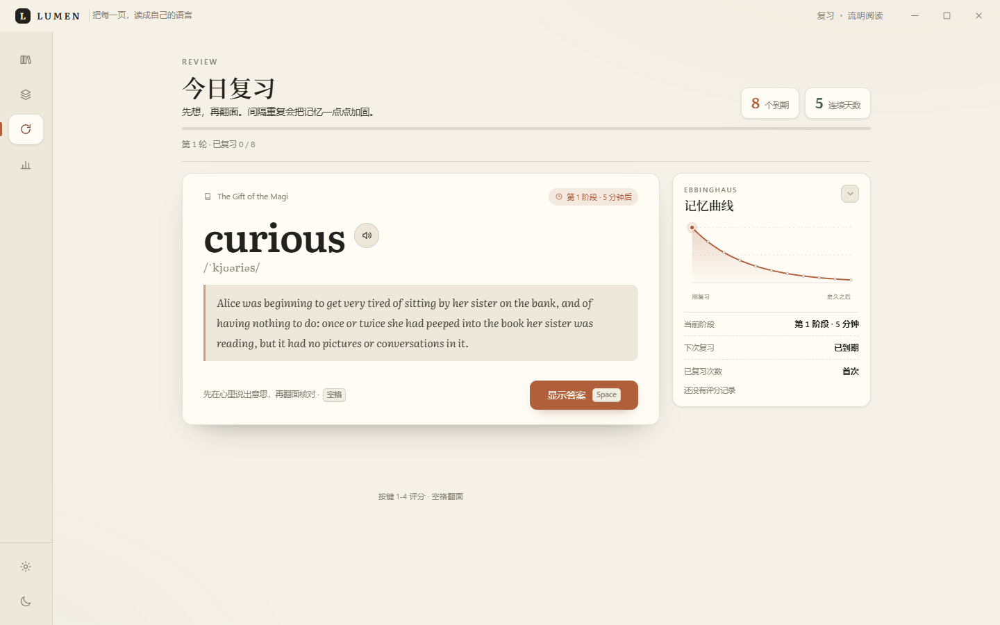
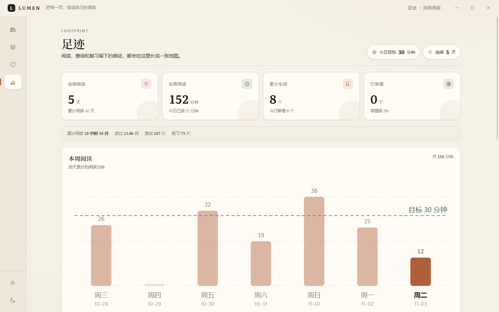
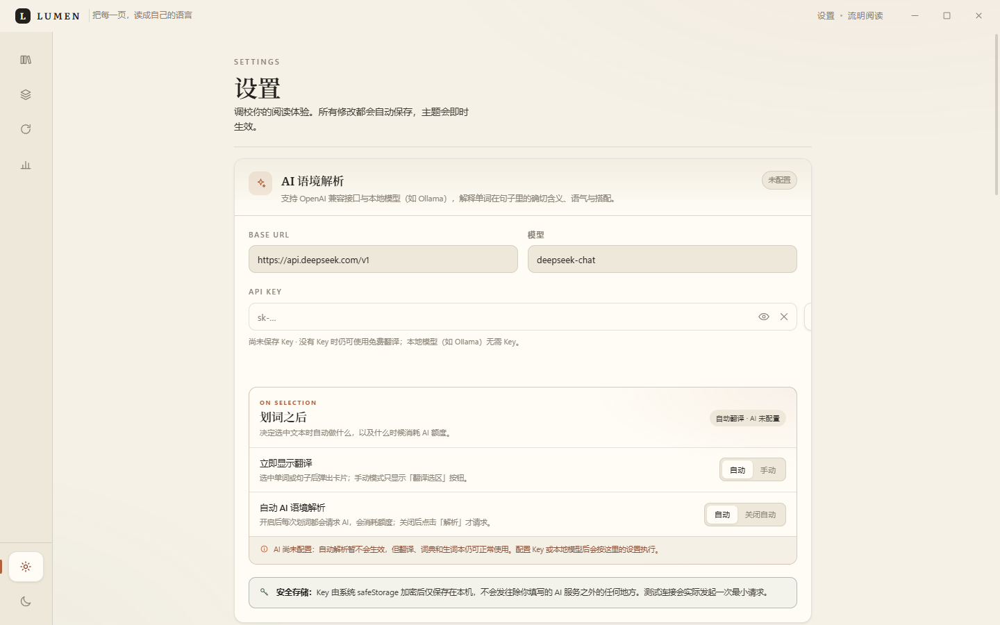
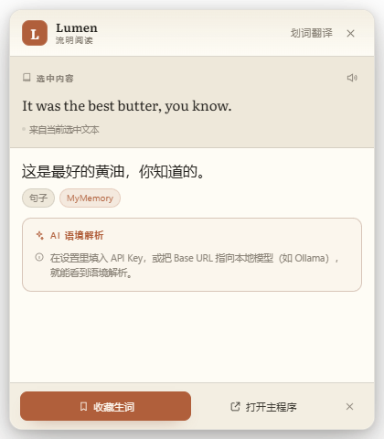
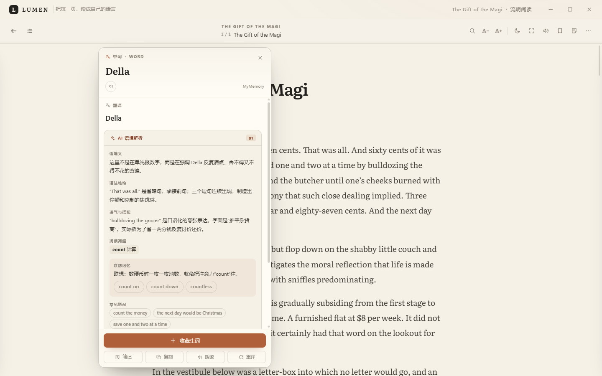
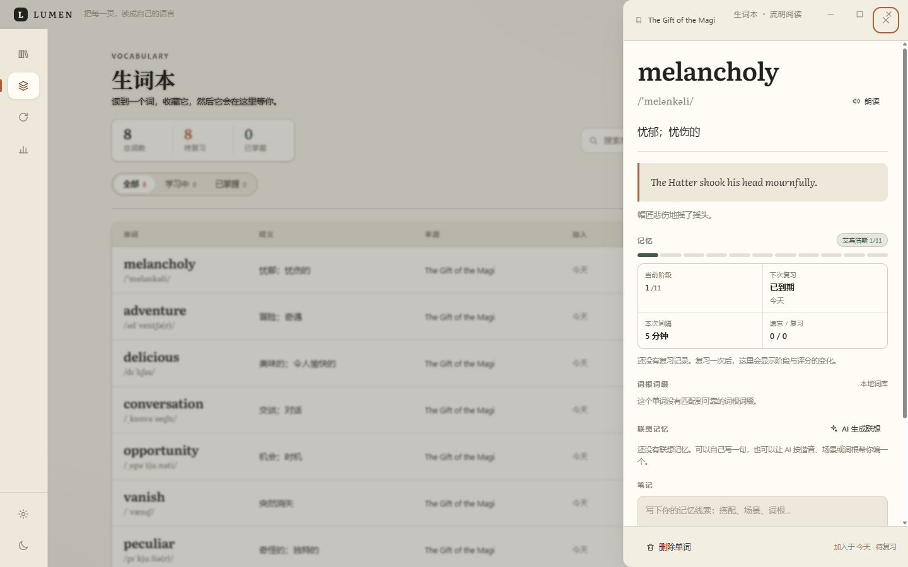
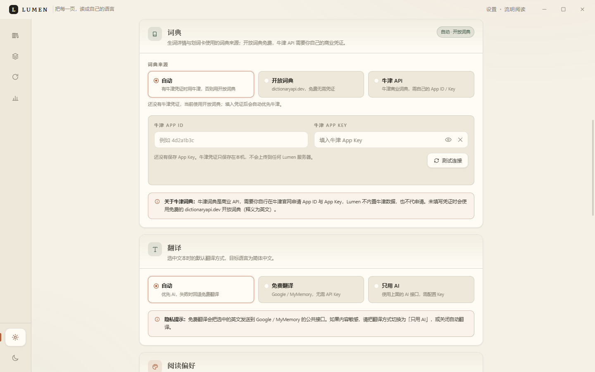

# Lumen · 流明阅读

> 把每一页，读成自己的语言。

Lumen 是一个**本地优先的 Windows 桌面英语阅读器**：导入 TXT 英文书，在安静的排版里阅读；选中任意单词或句子，立即看到中文翻译，再让 AI 讲清它在**这句话里**的意思；把值得记的词收进生词本，按间隔重复复习。

没有广告、没有账号、没有云书架。你的书、生词和阅读记录都留在自己的电脑里。


| 阅读器 | 划词翻译 |
| --- | --- |
|  |  |

| 生词本 | 复习 |
| --- | --- |
|  |  |

| 足迹 | 设置 |
| --- | --- |
|  |  |

| 全局划词浮窗 | AI 语境解析 |
| --- | --- |
|  |  |

| 生词记忆 | 词典与牛津凭证 |
| --- | --- |
|  |  |

> 截图中的阅读数据、生词和 AI 解析为演示数据；实际 AI 内容由你配置的模型生成。

---

## 为什么是 Lumen

大多数英语阅读工具只做“查词”：给你一个词典释义，然后你继续读。但阅读真正的卡点通常是**语境**：

- `bank` 是银行还是河岸？
- 这个 `rather` 是“相当”还是“宁愿”？
- 这句话的倒装，作者在强调什么？
- 这个词我认识，但在这个搭配里为什么读不通？

Lumen 把一次划词拆成三层：**先翻译（通常 1–3 秒）→ 再看语境（AI）→ 最后决定要不要记住**。不打断阅读，也不把阅读变成背单词。

## 功能

### 阅读
- 导入 UTF-8 / GB18030 / UTF-16 TXT，自动识别编码，原文件不动；
- 自动识别 Chapter / PART / Letter / 罗马数字章节，生成目录；
- 暖纸 / 暖褐 / 暗夜三套主题，字号、行高、版心、字距、衬线/无衬线、两端对齐均可调；
- 沉浸式阅读器：章节导航、阅读进度、书签、书内搜索、专注模式；
- 自动保存进度与阅读时长，下次从停下的地方继续。

### 划词翻译与词典
- 选中单词/句子，浮卡自动出现；单词给音标、真人发音（Windows TTS）；
- 词典释义更完整：词性、英文释义、例句、近义词 / 反义词、词形、词源；默认使用开放词典 dictionaryapi.dev；
- 支持接入你自己的**牛津词典 API**：在设置中填写 App ID / App Key，即可优先显示牛津释义；牛津是商业 API，Lumen 不内置、也不代申请；
- 免费翻译通道（Google / MyMemory）开箱即用，不需要 API Key；
- 翻译失败、断网、免费额度耗尽都有清晰降级，不打断阅读；
- 选中即可收藏，自动带上**原句、翻译、书名、章节**。

### AI 语境解析
- 兼容任意 OpenAI 格式接口：DeepSeek、OpenAI、通义、Kimi、OpenRouter、Ollama、LM Studio；
- 解析不止“翻译”：语境义、语法结构、语气与搭配、近义替换、例句、CEFR 难度；
- 新增词根词缀、联想记忆与同族词；AI 返回的联想会显示在划词卡和生词详情中；
- 结果缓存，重复查询不重复花钱；
- 设置里可选择「自动解析 / 关闭自动」：关闭后只有点击卡片里的「解析」才请求，避免额度被划词悄悄消耗；
- 不配置 AI 也能正常阅读和翻译，AI 是可选项。

### 生词本与复习
- 自动去重，保留原句上下文，按来源书/章节归档；
- **艾宾浩斯记忆曲线**：5 分钟 → 30 分钟 → 12 小时 → 1/2/4/7/15/30/60/120 天，共 11 个阶段；
- 复习页实时绘制保持率衰减曲线，四档评分直接显示下一次间隔；
- 生词详情显示当前阶段、下次复习与评分历史；
- **词根词缀 / 联想记忆**：本地 200+ 词素拆解；可让 AI 生成谐音、场景、词根联想并保存；
- 今日到期队列、键盘 1-4 评分、完成庆祝页；
- 掌握度 0-5 可视化，CSV 导出（Excel 可直接打开）。

### 足迹
- 连续阅读天数、本周阅读分钟、累计阅读词数、生词增长；
- 12 周阅读热力图、每日目标进度、掌握度分布；
- 最近查询与最近收藏。

### 全局划词（Windows）
- 在**任何应用**里选中英文，按 `Alt+Shift+D`，浮窗出现在鼠标旁；
- 翻译、朗读、AI 解析、一键收藏，不用切回主程序；
- 基于 Win32 剪贴板捕获，尽量不破坏你原本的剪贴板内容；
- 快捷键可在设置中修改。

### 桌面体验
- 无边框窗口、自定义标题栏、系统托盘；
- 关闭到托盘，不打断阅读；
- 全局快捷键切换页面（Ctrl+1 … Ctrl+5），Ctrl+6 回到上次阅读；
- 数据目录一键打开，一键备份/恢复。

## 快速开始

### 直接运行

```bat
run.bat
```

首次运行会自动安装依赖（需要 Node.js 18+，推荐 20/22）。开发模式：

```bash
npm install
npm start
```

### 打包 Windows 便携版

```bat
build.bat
```

产物在 `release/Lumen-1.1.0-portable.exe`（约 111 MB），双击即用，不需要安装。也可以直接运行 `release/win-unpacked/Lumen.exe`。

> 便携版未购买代码签名证书，Windows SmartScreen 可能提示“未知发布者”；选择“仍要运行”即可。

## 配置 AI（可选）

打开 **设置 → AI 语境解析**：

| 服务 | Base URL | 模型 | API Key |
| --- | --- | --- | --- |
| DeepSeek（推荐） | `https://api.deepseek.com/v1` | `deepseek-chat` | 在 platform.deepseek.com 获取 |
| OpenAI | `https://api.openai.com/v1` | `gpt-4o-mini` | 在 platform.openai.com 获取 |
| Ollama（本地） | `http://localhost:11434/v1` | `qwen2.5:7b` | 留空即可 |
| LM Studio（本地） | `http://localhost:1234/v1` | 已加载模型名 | 留空即可 |

API Key 使用 Windows `safeStorage`（DPAPI）加密后保存在本机，只用于向你自己配置的接口发起请求。

> 不配置 AI 也能使用全部阅读、翻译、生词和复习功能。AI 只影响“语境解析”这一层。

## 配置牛津词典（可选）

设置 → 词典 → 选择「牛津 API」，填写：

- **App ID**：牛津开发者控制台提供；
- **App Key**：与 App ID 配套，使用系统 DPAPI 加密保存在本机。

牛津词典是商业授权数据，需要你自己在 Oxford Dictionaries 官网申请 API 凭证；Lumen 不内置牛津数据、也不代申请。没有凭证时自动使用免费开放词典；牛津请求失败时会回退开放词典，并在卡片上标注来源。

## 记忆曲线说明

复习采用艾宾浩斯间隔：

| 阶段 | 间隔 | 阶段 | 间隔 |
| --- | --- | --- | --- |
| 1 | 5 分钟 | 7 | 7 天 |
| 2 | 30 分钟 | 8 | 15 天 |
| 3 | 12 小时 | 9 | 30 天 |
| 4 | 1 天 | 10 | 60 天 |
| 5 | 2 天 | 11 | 120 天 |
| 6 | 4 天 |  |  |

评分：重来回到第 1 阶段；困难退一阶段；记得进一阶段；简单进两阶段。

## 快捷键

| 快捷键 | 功能 |
| --- | --- |
| `Alt+Shift+D` | 全局划词（任意应用） |
| `Ctrl+1 … Ctrl+5` | 书库 / 生词本 / 复习 / 足迹 / 设置 |
| `Ctrl+6` | 回到上次阅读的书 |
| `← / →` | 阅读器上一章 / 下一章 |
| `Ctrl+F` | 书内搜索 |
| `F` | 专注模式 |
| `T` | 朗读当前段落 |
| `Ctrl+S` | 收藏当前选中词 |
| `Esc` | 关闭浮卡 / 弹窗 |
| `空格` | 复习卡翻面 |
| `1 / 2 / 3 / 4` | 复习评分：重来 / 困难 / 记得 / 简单 |

## 数据与隐私

- 书库、生词、笔记、统计、设置全部保存在 `%APPDATA%\Lumen\`（设置页可直接打开）；
- API Key 使用系统 DPAPI 加密；
- 免费翻译会把**当前选中的文本**发送到 Google / MyMemory；切换到 AI 后只发送给你配置的模型服务；
- 不收集遥测，不需要登录，不上传书库；
- 示例书均为 Project Gutenberg 公有领域文本，详见 `resources/samples/SOURCES.md`。

## 技术栈

- Electron 45 + 原生 HTML / CSS / ES Modules，无前端构建步骤；
- 主进程 CommonJS，渲染进程 `contextIsolation` + `sandbox` 关闭（preload 仅暴露白名单 API）；
- 本地 JSON 原子存储，无数据库依赖；
- Literata 可变字体本地打包；
- Windows 全局划词由自带的小型 C# helper 完成（`tools/SelectionGrabber.cs`）。

## 项目结构

```text
src/
  main/            Electron 主进程
    services/      导入、翻译、AI、生词、统计等纯 Node 服务
    util/          编码识别、章节解析
    main.js       入口 / 托盘 / 窗口
    ipc.js         IPC 白名单
    preload.js     contextBridge API
  renderer/        书库、阅读器、生词本、复习、统计、设置、划词浮窗
resources/
  samples/         6 本公版英文书
  SelectionGrabber.exe
tests/             node:test 单元测试
docs/              接口契约、产品分析、截图
```

## 测试

```bash
npm test               # 111 个核心服务单元测试
npm run selftest       # 28 项 Electron 端到端检查（本地 mock AI）
npm run screenshots    # 真实 Electron 渲染 + 产品截图
```

端到端检查覆盖：示例书播种、路由、章节标题、划词翻译、AI 语境解析、词根分析、
AI 联想、艾宾浩斯排程、收藏生词、复习曲线、词典设置、主题持久化、TXT 导入、
快捷浮窗翻译与收藏、关闭自动解析、全局快捷键注册。

完整验收记录见 [docs/QA-REPORT.md](docs/QA-REPORT.md)。

## 已知限制

- 当前只支持 TXT；EPUB / PDF / 网页文章在路线图中；
- 全局划词依赖 Windows 前台窗口与剪贴板，极少数全屏游戏/受保护应用可能无法捕获；
- 免费翻译需要联网，Google 在部分网络不可用时自动降级 MyMemory，单词/短句约 2–5 秒，长段落按句分块翻译约 5–9 秒；
- AI 解析需要你自己配置 Base URL / Key（本地 Ollama 可免 Key），软件不内置公共模型额度；
- 牛津词典需要你自己的 Oxford API 凭证；无凭证时使用开放词典；
- 联想记忆、词根 AI 解读需要配置 AI；本地词根拆分无需联网；
- 便携版未签名，SmartScreen 可能提示未知发布者。

## 接下来

完整竞品拆解与功能优先级见 [docs/feature-analysis.md](docs/feature-analysis.md)。我们最想做的三件事：

1. **EPUB / 网页文章导入**：让“读什么”不再受 TXT 限制；
2. **段落级双语对照 + 整章精读**：从“查一个词”升级为“读懂一章”；
3. **FSRS + Anki 导出 + 跨设备同步**：让生词真正进入长期记忆。

## License

MIT。示例书文本遵循 Project Gutenberg License。